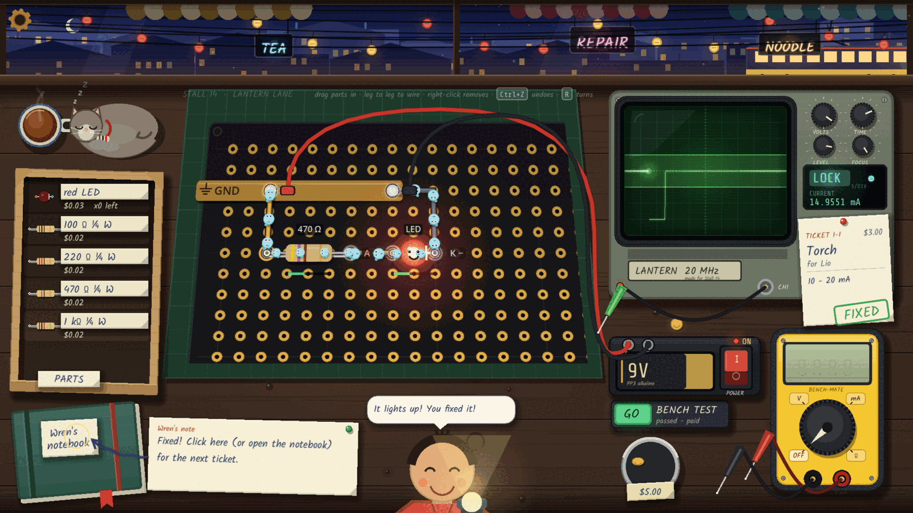
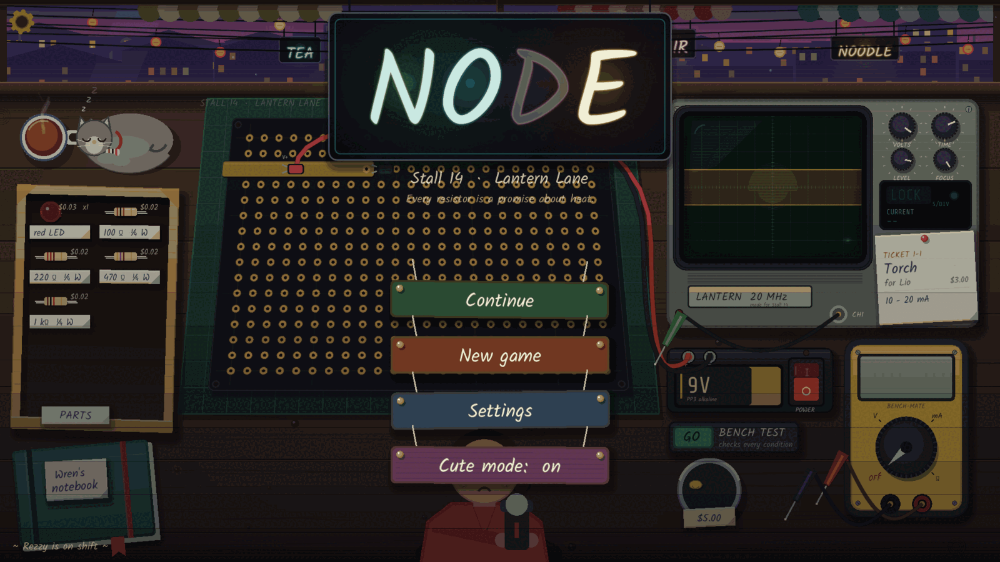
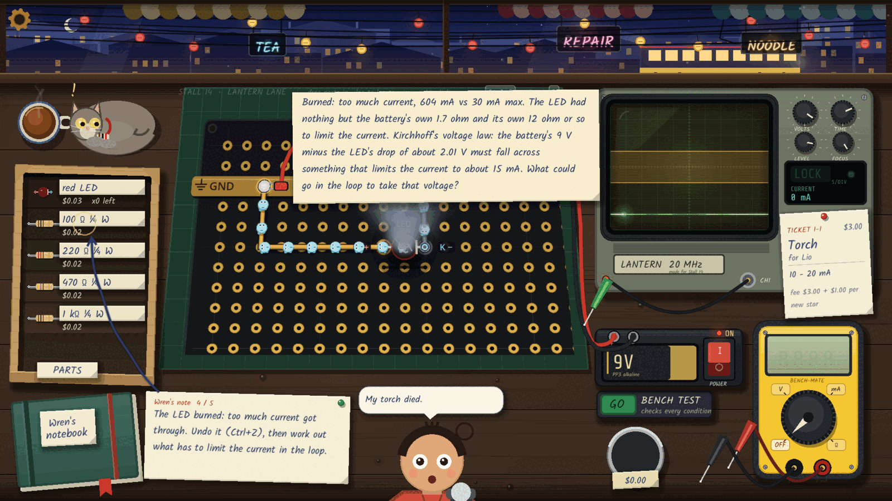
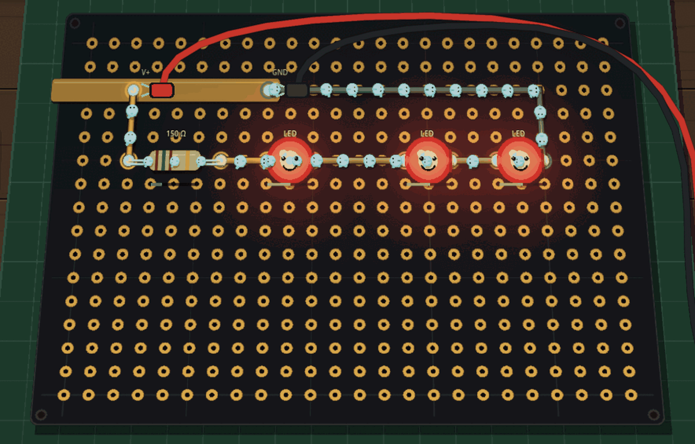
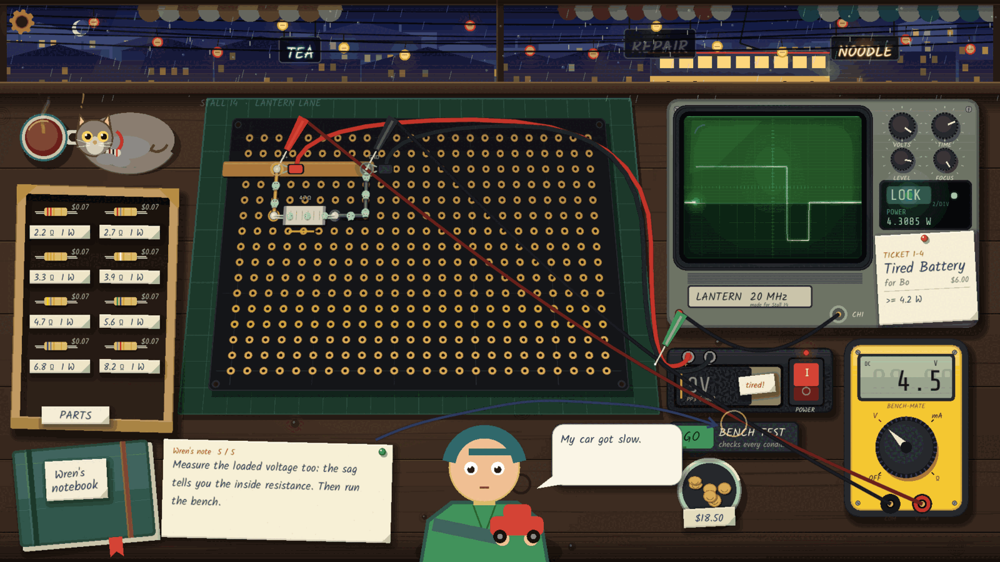
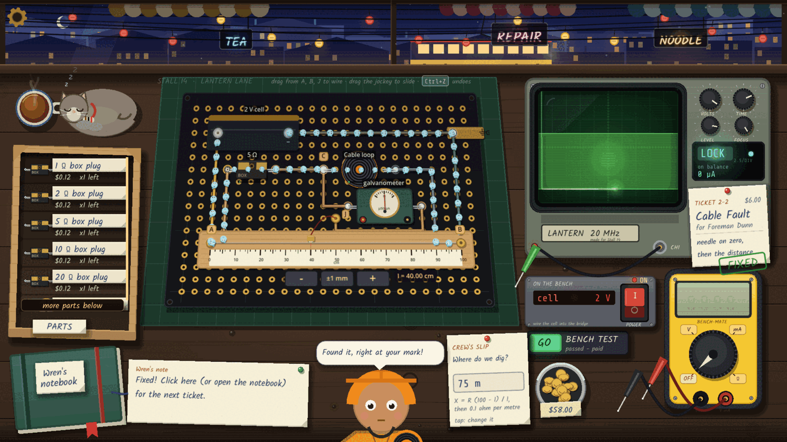
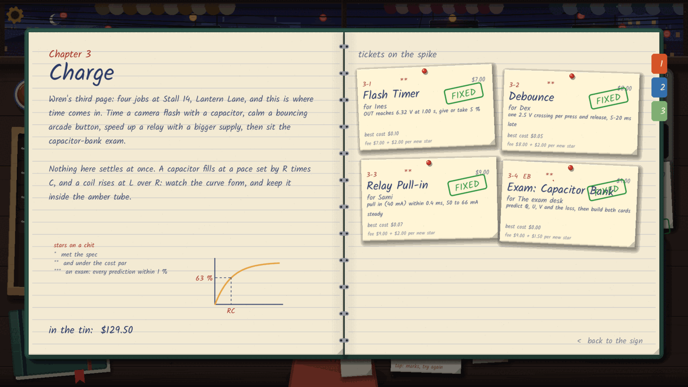

# 🔌 CIRCUITS: a night-market electronics stall where real circuits are the rules

**[Changelog](CHANGELOG.md)** · **[Design](docs/DESIGN.md)** · **[Status](docs/STATUS.md)**

**Run Wren's repair stall on Lantern Lane.** Customers bring a dead torch, a slow toy car, a relay that pulls in late. You drag real parts
from the shoebox onto a perfboard, wire them pad to pad, flip the power switch and watch the oscilloscope trace. Get it wrong and the LED
cracks and smokes, the resistor glows, the capacitor vents, and the game tells you why in plain words, with the numbers from your own
circuit. Get it right and the trace locks in the band, the customer grins and coins drop in the tin.

The front end is a **Godot 4.7** game. Every volt, amp and second comes from a **deterministic TypeScript circuit engine** (a modified
nodal analysis solver with DC, transient and device models) that Godot drives through a Node sidecar. The interface computes no numbers
of its own.

> **Pre-alpha.** Chapters 1 to 3 (13 tickets) are playable end to end on desktop and at Steam Deck size, and each was won by a fresh
> play-tester from in-game guidance alone. Chapter 4 "Mains & Rectifiers" is being built. Chapters 5 to 8 are designed, not built. No
> phone build, no sound pass and no gamepad pass yet.



## What you actually do

| | |
|---|---|
| **Take a ticket** | A customer at the counter and a paper chit pinned to the scope: what is broken and the band the fix must sit in. |
| **Build** | Drag resistors, LEDs, capacitors, relays, meters and wire from the parts box onto gold pads. Wires join only at their ends; crossings hop over. |
| **Power up** | A rocker switch on the battery holder or bench supply. Current shows as moving dots, hot parts glow, LEDs bloom. |
| **Fail first** | Too much current and the LED die cracks and smokes. The note quotes what your circuit did ("took 0.604 A, more than 3 times its 0.03 A rating"). A repeat failure gets the worked formula. |
| **Measure** | Drag the multimeter's probes onto pads; clip the scope onto a node. Some tickets cannot be passed without measuring. |
| **Lock** | The trace settles inside the amber band, the VFD shows LOCK, and the bench test checks every condition with the power on. |
| **Sit exams** | Exam tickets ask for predictions before you build. The band stays hidden until you commit; then your numbers are marked against the bench and worked out on paper. |
| **Read Wren's notebook** | The coach and the Codex are one handwritten notebook: steps that follow what you have really done, and a page per law. |

## The campaign

Eight chapters take a player from a first LED to oscillators. Three are built:

| Chapter | Teaches | Tickets |
|---|---|---|
| **1 First Light** | Ohm's law, series LEDs, power and heat, internal resistance, cells in series | Torch · Tail-light · Hot Resistor · Tired Battery · Exam: Two Batteries |
| **2 Divide & Measure** | Dividers, the Wheatstone bridge, the metre bridge, the potentiometer | Dimmer · Cable Fault · Bridge · Exam: Potentiometer |
| **3 Charge** | RC charging, time constants, debouncing, RL rise, capacitor energy | Flash Timer · Debounce · Relay Pull-in · Exam: Capacitor Bank |
| 4 Mains & Rectifiers *(in progress)* | AC, diodes, rectifiers, ripple, regulators, mains safety | |
| 5 Switches & Gain · 6 Op-Amp Alley · 7 Tone & Resonance · 8 Oscillate *(designed)* | Transistors, op-amps, filters, resonance, oscillators | |

Stars on a chit: one for meeting the spec, two for also beating the cost par, three on exams for every prediction within 1 %.

**Cute mode** (on by default) turns current dots into electron critters whose speed follows the current, and gives each LED a face that
follows its rating: sleepy when starved, happy in spec, sweating when overdriven, cracked when it burns. Rezzy the cat wakes up when
something gets hot. Every cute element shows a physical quantity; none hides one.

## Honest by design

- **The engine owns every number and every sentence that quotes one.** Explanations are computed from the same trace the scope shows.
- **No answer leaks.** Exam bands stay hidden until predictions are locked; "balanced" text needs a real null sweep.
- **Checks are real.** The bench test fails with the power off, and a floating circuit reads as floating.
- **Named simplifications** live in the level headers and the Codex (generic values for small electrolytics, for example).
- **Mains is simulated only.** Chapter 4 opens with a safety card and never tells anyone to build on real mains.

## Screenshots

| | |
|---|---|
| <br>**The stall at dusk.** The title is the bench. | <br>**The hook.** An LED straight across 9 V cracks and smokes. |
| <br>**Cute mode.** LED faces and electron critters follow the current. | <br>**Measure it.** A tired battery sags under load; the meter shows it. |
| <br>**Power is heat.** An under-rated resistor glows. | <br>**Cable Fault.** A metre bridge finds the break by a null on the galvanometer. |
| <br>**Electrolytics vent.** A 6.3 V part on 7.7 V. | <br>**Relay Pull-in.** The coil current rises along L over R on the scope. |
| <br>**Exams are marked.** Your predictions against the bench, then the worked solution. | <br>**The chapter page.** Tickets pinned in Wren's notebook. |
| <br>**The notebook.** Coach steps on the left, the law on the right. | <br>**Steam Deck size** (1280x800). |

## Run from source
```
git clone --recursive <this repo>        # or: git submodule update --init
pnpm install
pnpm bridge                              # builds the engine sidecar → godot/sidecar/bridge.mjs
godot --headless --path godot --import   # once, and after adding class_name scripts
godot --path godot                       # play
```
Needs Node.js 18+ and Godot 4.7.2.

## Architecture
```
src/sim/mna/        circuit solver: stamps, DC, transient, device models (diode, LED, relay, switch…)
src/engine/         actions and queries, bench check, explanations, exam marking, coach steps
src/data/levels/    one file per ticket: parts bin, reference, fails, oracle numbers, deviations
godot/stall/        the stall: bench scene, scope, meter, notebook, part art
godot/tests/        one UI flow per chapter, driven headless
core/               cobanana-core submodule: bridge, saves, settings, layout, QA harness
```

| task | command |
|---|---|
| typecheck | `pnpm typecheck` |
| engine tests (oracles, goldens, levels) | `pnpm test` |
| regenerate goldens (deliberate rule change only) | `GOLDEN_UPDATE=1 pnpm test` |
| a UI flow | `godot --headless --path godot -s res://tests/ch3_engine_flow.gd` |
| screenshots and testers | `core/qa/README.md` |

## Status and known gaps
- Chapters 4 to 8, sound, gamepad focus, the phone layout and the Android build are not done.
- Most of the perfboard is unused on small tickets, and a customer's speech bubble can cover the bench-test button.
- The three-star tolerance run on build tickets is designed but not built.
