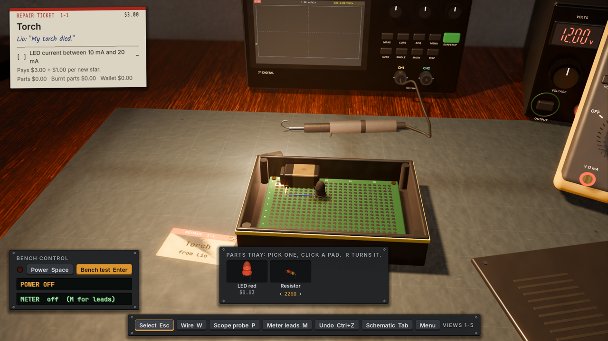
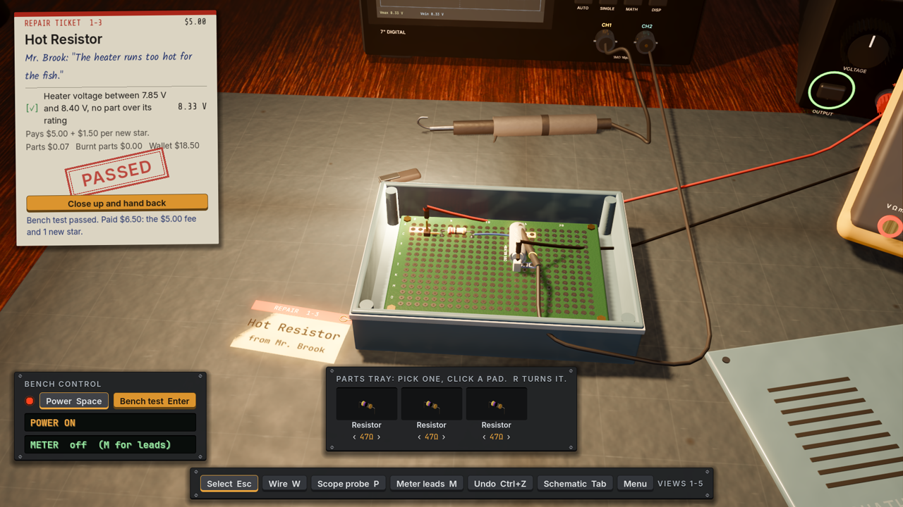
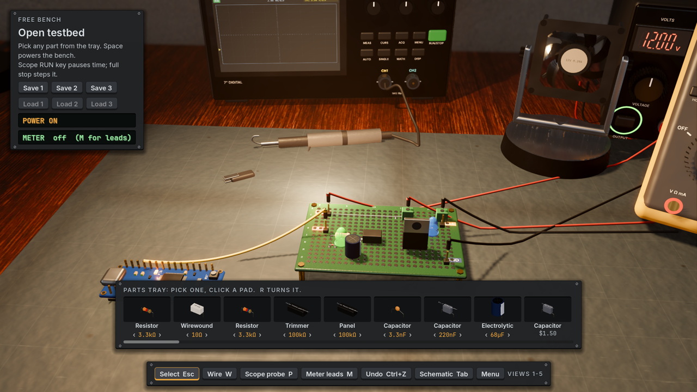
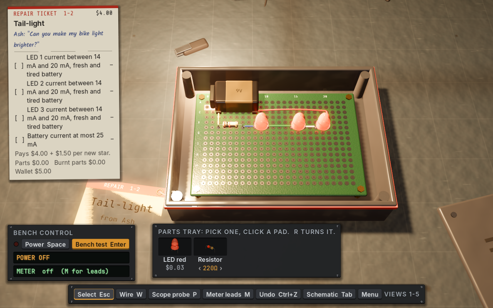
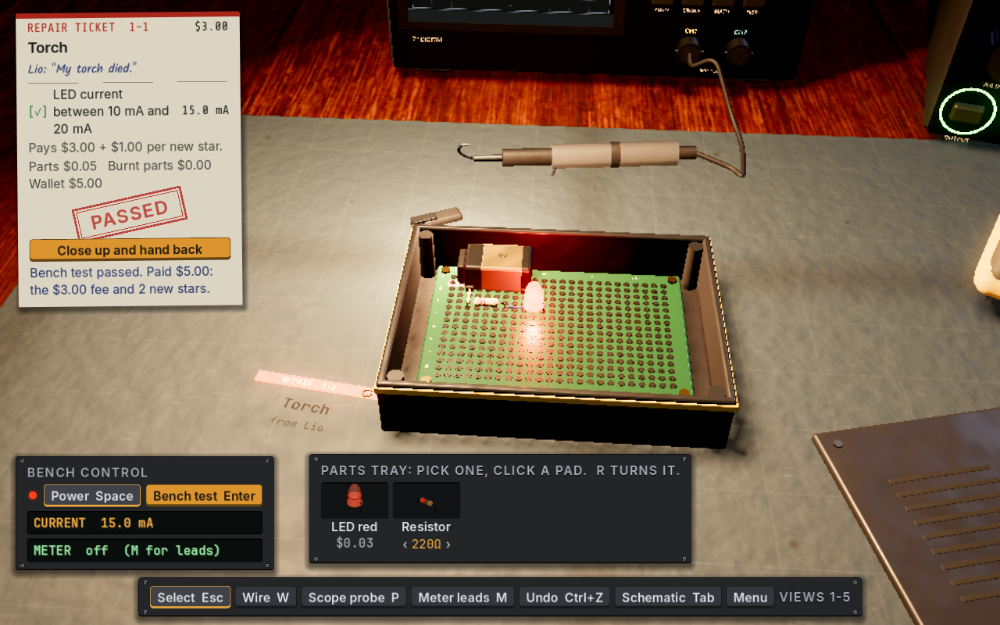
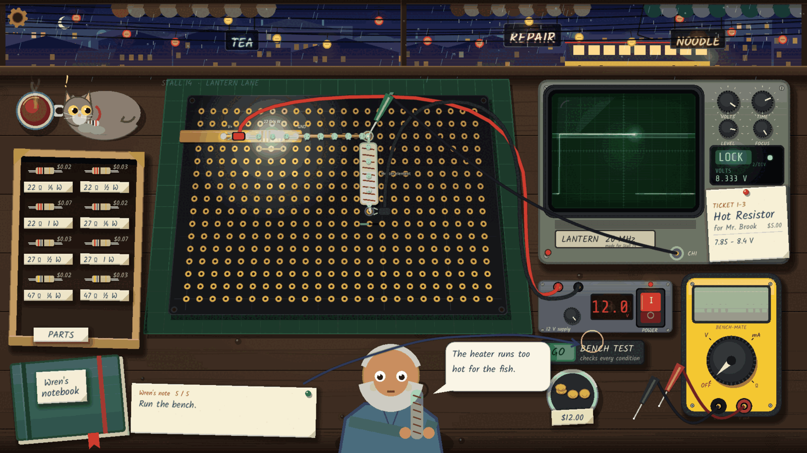
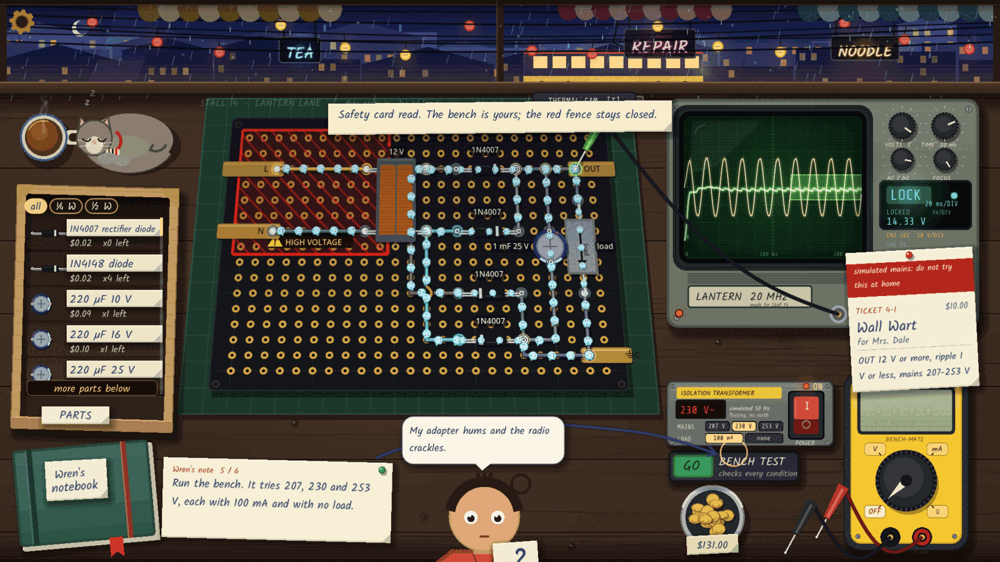
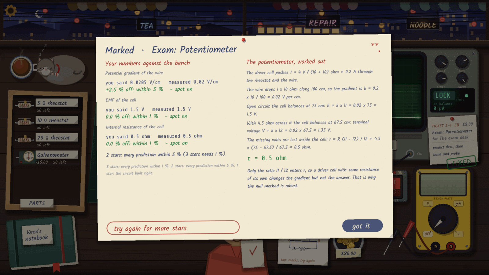
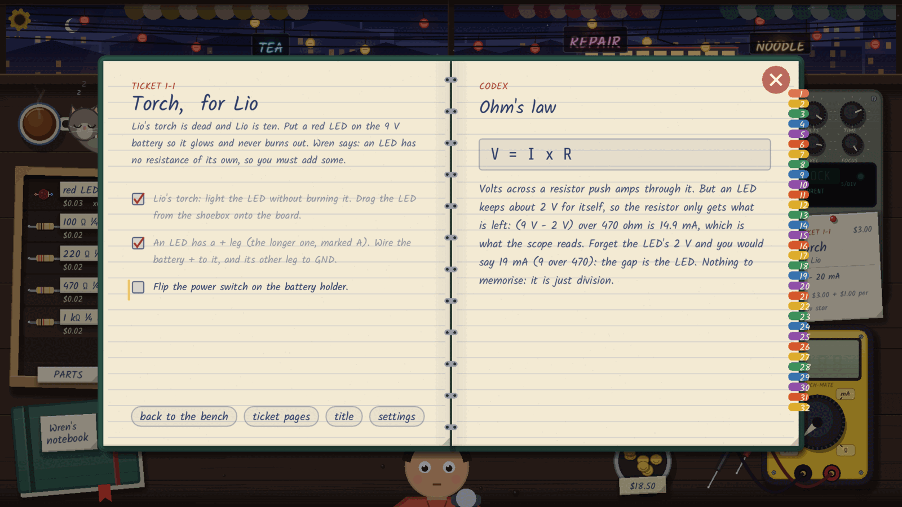

# 🔌 CIRCUITS: a repair bench where real circuits are the rules

**[Changelog](CHANGELOG.md)** · **[Design](docs/DESIGN.md)** · **[Status](docs/STATUS.md)** · **[The new look](docs/LOOK2.md)**

Customers bring broken devices to your bench. Open them, probe them, fix them with real parts, and hand them back.

> **v0.3.0, pre-alpha.** Chapter 1 plays on the 3D bench; chapters 2 to 5 play in the classic 2D look. Linux build on the [releases page](https://github.com/blackmetaltech/circuits/releases/latest).


| | |
|---|---|
| <br>**A repair arrives.** The case opens on the customer's own faulty board. | <br>**The scope runs live.** The fan driver switching at 100 Hz. |
| <br>**1-1 Torch.** An LED straight on 9 V. Dead. | <br>**Fixed.** 470 ohm, 15.0 mA, stamped PASSED. |
| <br>**1-3 Heater.** 22 ohm drops 12 V to 8.33 V. | <br>**Free bench.** Any part, three save slots. |
| <br>**Steam Deck size** (1280x800). | <br>**Low tier** on an integrated GPU. |

## What you do

| | |
|---|---|
| **Take the job** | The ticket says what is broken and what the fix must meet. |
| **Open the case** | A repair comes with the customer's faulty board. Probe it first. |
| **Fix it** | Place parts from the tray and wire them pad to pad. |
| **Power and test** | The bench test checks every spec with the power on. A burnt part comes out of your pay. |
| **Read why** | A failure names the cause with your circuit's own numbers. |
| **Sit exams** | Predict first, then build. Your numbers are marked against the bench. |

## The campaign

Five chapters are built (23 tickets). Three more are designed.

| Chapter | Teaches | Tickets |
|---|---|---|
| **1 First Light** | Ohm's law, series LEDs, power and heat, internal resistance, cells in series | Torch · Tail-light · Hot Resistor · Tired Battery · Exam: Two Batteries |
| **2 Divide & Measure** | Dividers, the Wheatstone bridge, the metre bridge, the potentiometer | Dimmer · Cable Fault · Bridge · Exam: Potentiometer |
| **3 Charge** | RC charging, time constants, debouncing, RL rise, capacitor energy | Flash Timer · Debounce · Relay Pull-in · Exam: Capacitor Bank |
| **4 Mains & Rectifiers** | Diodes, the bridge rectifier, ripple and C, Zener shunts, linear regulators and their heat, mains safety (simulated mains only) | Wall Wart · Zener Shunt · Hot Regulator · Bench Supply · Exam: Zener Regulator |
| **5 Switches & Gain** | The transistor as a switch (forced gain, flyback diodes), MOSFET thresholds and heat, diode-transistor logic, the common-emitter amplifier and its bias | Fan Driver · 3.3 V Gate · Gate Builder · Synth Preamp · Exam: CE Amplifier |
| 6 Op-Amp Alley · 7 Tone & Resonance · 8 Oscillate *(designed)* | Op-amps, filters, resonance, oscillators | |

Cute mode (classic look) gives LEDs faces and turns current into critters. Each one shows a real quantity.

## Honest by design

- A circuit simulator owns every number. The interface computes none.
- Exam targets stay hidden until you lock your predictions.
- The bench test fails with the power off. A floating circuit reads as floating.
- Mains is simulated only.

The front end is Godot 4.7. The engine is a deterministic TypeScript circuit solver, run through a Node sidecar.

## The classic look (chapters 2 to 5)

| | |
|---|---|
| <br>**The stall at dusk.** | <br>**The hook.** An LED straight across 9 V cracks and smokes. |
| <br>**Cute mode.** Faces and critters follow the current. | <br>**Measure it.** A tired battery sags under load; the meter shows it. |
| <br>**Power is heat.** An under-rated resistor glows. | <br>**Cable Fault.** A metre bridge finds the break. |
| <br>**Electrolytics vent.** A 6.3 V part on 7.7 V. | <br>**Relay Pull-in.** The coil current rises along L over R on the scope. |
| <br>**Wall Wart.** The scope shows the ripple. | <br>**Hot Regulator.** A bare 7805 cycles on thermal shutdown. |
| <br>**Fan Driver.** No flyback diode: the transistor burns. | <br>**Synth Preamp.** A common-emitter stage on the scope.
| <br>**Exams are marked.** Your numbers against the bench. | <br>**The chapter page.** Tickets pinned in Wren's notebook. |
| <br>**The notebook.** Coach steps and the law. | <br>**Steam Deck size** (1280x800). |

## Run from source
```
git clone --recursive https://github.com/blackmetaltech/circuits   # core/ is a private submodule (cobanana-core): building needs access to it
pnpm install
pnpm bridge                              # builds the engine sidecar → godot/sidecar/bridge.mjs
godot --headless --path godot --import   # once, and after adding class_name scripts
godot --path godot                       # play
```
Needs Node.js 18+ and Godot 4.7.2. To just play, take the Linux zip from the [releases page](https://github.com/blackmetaltech/circuits/releases) (Node.js is bundled).

## Architecture
```
src/sim/mna/        circuit solver: stamps, DC, transient, device models (diode, LED, relay, switch…)
src/engine/         actions and queries, bench check, explanations, exam marking, coach steps
src/data/levels/    one file per ticket: parts bin, reference, fails, oracle numbers, deviations
godot/stall/        the stall: bench scene, scope, meter, notebook, part art
godot/tests/        one UI flow per chapter, driven headless
core/               cobanana-core submodule: bridge, saves, settings, layout, QA harness
```

| task | command |
|---|---|
| typecheck | `pnpm typecheck` |
| engine tests (oracles, goldens, levels) | `pnpm test` |
| regenerate goldens (deliberate rule change only) | `GOLDEN_UPDATE=1 pnpm test` |
| a UI flow | `godot --headless --path godot -s res://tests/ch5_engine_flow.gd` |
| screenshots and testers | `core/qa/README.md` |

## Status and known gaps
- No human has played the 3D bench yet. No sound or gamepad there yet.
- Only a Linux build is published.
- Details: [docs/CRITIQUE-0.3.md](docs/CRITIQUE-0.3.md).
