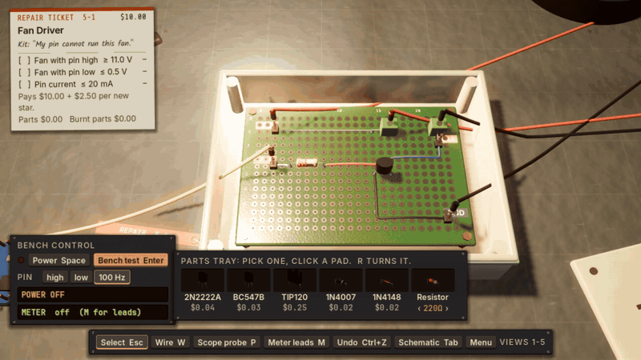
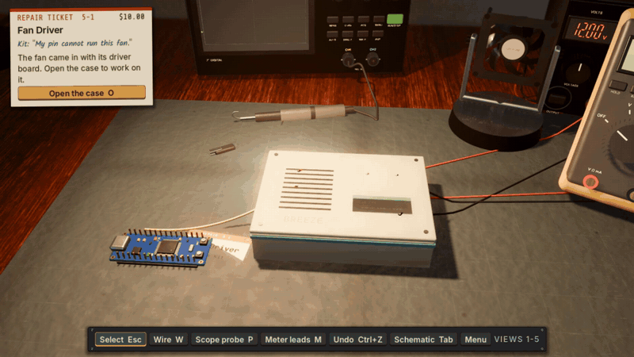
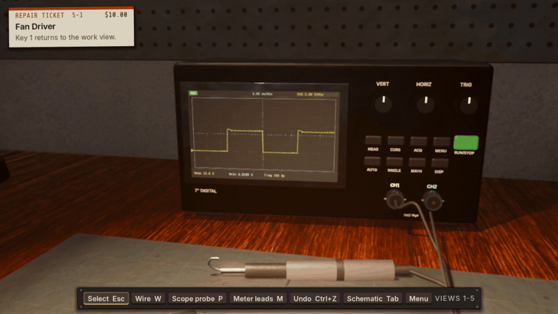
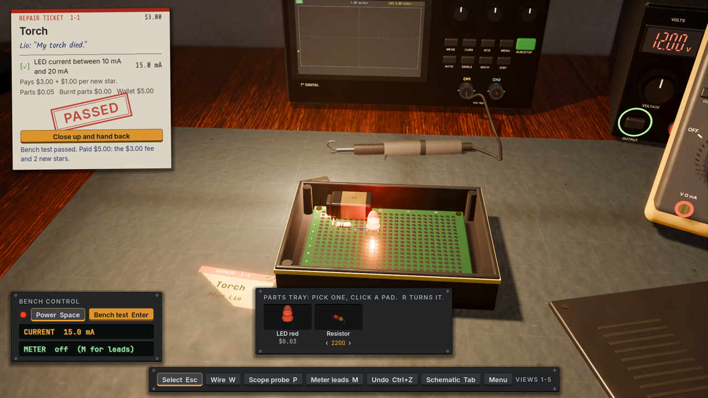
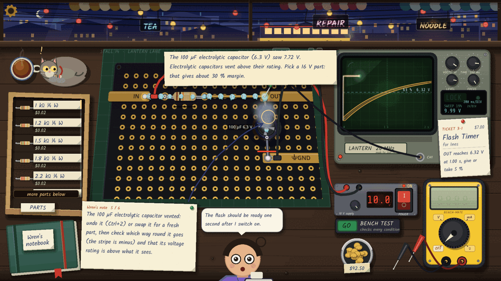
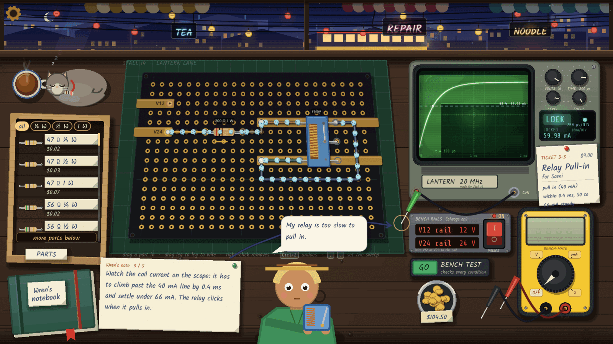
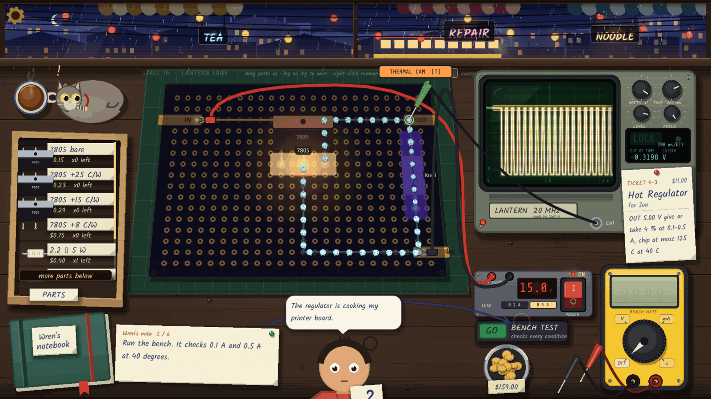
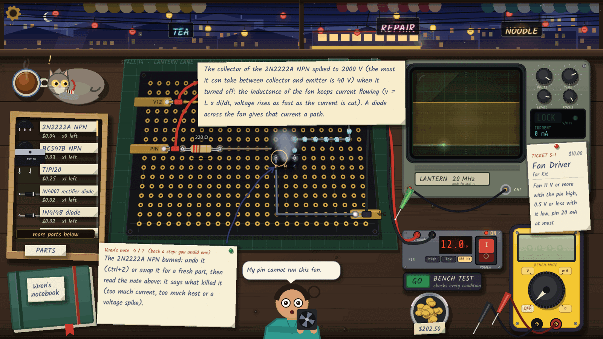
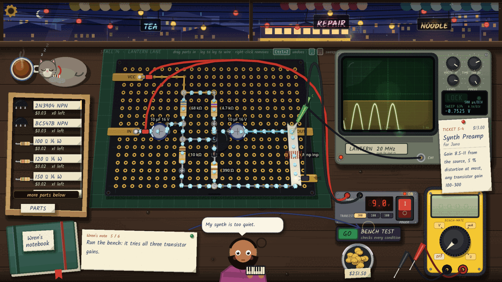
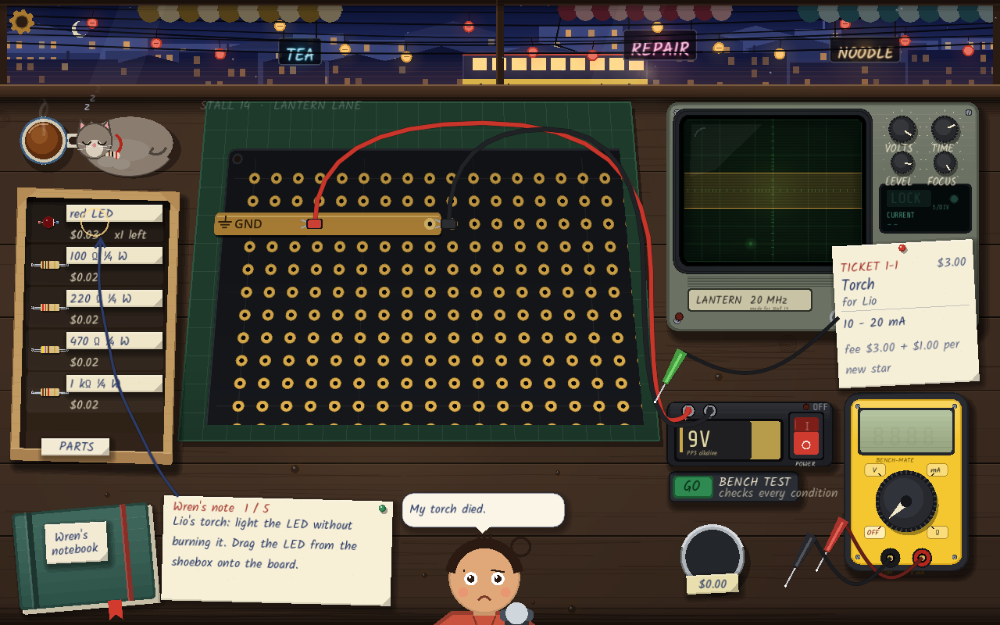

# 🔌 CIRCUITS: a repair bench where real circuits are the rules

**[Changelog](CHANGELOG.md)** · **[Design](docs/DESIGN.md)** · **[Status](docs/STATUS.md)** · **[The new look](docs/LOOK2.md)**

**Customers bring broken devices to your bench.** A torch that died, a bike light too dim to be seen, a fish-tank heater running hot,
a toy car that crawls, a desk fan that burned its driver. Open the case, probe the old work with the meter and the scope, fix it with
real parts, and hand it back. Burn a part and it comes out of your pay; the game tells you why it burned, with the numbers from your own
circuit. A free bench lets you place any part, power it, probe it and save the build.

The front end is a **Godot 4.7** game. Every volt, amp and second comes from a **deterministic TypeScript circuit engine** (a modified
nodal analysis solver with DC, transient and device models) that Godot drives through a Node sidecar. The interface computes no numbers
of its own.

> **v0.3.0 "Workbench", pre-alpha.** A new 3D look: chapter 1 (five tickets, four of them repairs) and the 5-1 fan repair play on the
> workbench; chapters 2 to 5 (23 tickets in all) play in the classic 2D stall, one switch away on both title screens. Desktop and Steam Deck
> size (1280x800); the low tier runs at about 65 fps on an integrated Radeon. No sound and no gamepad in the new look yet; the new look was
> hand-played by an agent persona, not yet by a human. The [v0.3.0 release](https://github.com/blackmetaltech/circuits/releases/tag/v0.3.0) is a Linux x86_64 build.



| | |
|---|---|
| <br>**A repair arrives.** The case opens on the customer's own faulty board. | <br>**The scope runs live.** The fan driver switching at 100 Hz. |
| <br>**1-1 Torch.** The LED was wired straight across the 9 V battery. It is dead. | <br>**Fixed.** 470 ohm, 15.0 mA, stamped PASSED. |
| <br>**1-3 Heater.** 22 ohm, 1 W drops the 12 V supply to 8.33 V. | <br>**Free bench.** Any part, three save slots. |
| <br>**Steam Deck size** (1280x800). | <br>**Low tier** on an integrated GPU. |

## What you actually do

| | |
|---|---|
| **Take a ticket** | A customer at the counter and a paper chit pinned to the scope: what is broken and the band the fix must sit in. |
| **Build** | Drag resistors, LEDs, capacitors, relays, meters and wire from the parts box onto gold pads. Wires join only at their ends; crossings hop over. |
| **Power up** | A rocker switch on the battery holder or bench supply. Current shows as moving dots, hot parts glow, LEDs bloom. |
| **Fail first** | Too much current and the LED die cracks and smokes. The note quotes what your circuit did ("took 0.604 A, more than 3 times its 0.03 A rating"). A repeat failure gets the worked formula. |
| **Measure** | Drag the multimeter's probes onto pads; clip the scope onto a node. Some tickets cannot be passed without measuring. |
| **Lock** | The trace settles inside the amber band, the VFD shows LOCK, and the bench test checks every condition with the power on. |
| **Sit exams** | Exam tickets ask for predictions before you build. The band stays hidden until you commit; then your numbers are marked against the bench and worked out on paper. |
| **Read Wren's notebook** | The coach and the Codex are one handwritten notebook: steps that follow what you have really done, and a page per law. |

## The campaign

Eight chapters take a player from a first LED to oscillators. Five are built (23 tickets):

| Chapter | Teaches | Tickets |
|---|---|---|
| **1 First Light** | Ohm's law, series LEDs, power and heat, internal resistance, cells in series | Torch · Tail-light · Hot Resistor · Tired Battery · Exam: Two Batteries |
| **2 Divide & Measure** | Dividers, the Wheatstone bridge, the metre bridge, the potentiometer | Dimmer · Cable Fault · Bridge · Exam: Potentiometer |
| **3 Charge** | RC charging, time constants, debouncing, RL rise, capacitor energy | Flash Timer · Debounce · Relay Pull-in · Exam: Capacitor Bank |
| **4 Mains & Rectifiers** | Diodes, the bridge rectifier, ripple and C, Zener shunts, linear regulators and their heat, mains safety (simulated mains only) | Wall Wart · Zener Shunt · Hot Regulator · Bench Supply · Exam: Zener Regulator |
| **5 Switches & Gain** | The transistor as a switch (forced gain, flyback diodes), MOSFET thresholds and heat, diode-transistor logic, the common-emitter amplifier and its bias | Fan Driver · 3.3 V Gate · Gate Builder · Synth Preamp · Exam: CE Amplifier |
| 6 Op-Amp Alley · 7 Tone & Resonance · 8 Oscillate *(designed)* | Op-amps, filters, resonance, oscillators | |

Stars on a chit: one for meeting the spec, two for also beating the cost par, three on exams for every prediction within 1 %.

**Cute mode** (on by default) turns current dots into electron critters whose speed follows the current, and gives each LED a face that
follows its rating: sleepy when starved, happy in spec, sweating when overdriven, cracked when it burns. Rezzy the cat wakes up when
something gets hot. Every cute element shows a physical quantity; none hides one.

## Honest by design

- **The engine owns every number and every sentence that quotes one.** Explanations are computed from the same trace the scope shows.
- **No answer leaks.** Exam bands stay hidden until predictions are locked; "balanced" text needs a real null sweep.
- **Checks are real.** The bench test fails with the power off, and a floating circuit reads as floating.
- **Named simplifications** live in the level headers and the Codex (generic values for small electrolytics, for example).
- **Mains is simulated only.** Chapter 4 opens with a safety card and never tells anyone to build on real mains.

## Screenshots: the classic stall (chapters 1 to 5)

| | |
|---|---|
| <br>**The stall at dusk.** The title is the bench. | <br>**The hook.** An LED straight across 9 V cracks and smokes. |
| <br>**Cute mode.** LED faces and electron critters follow the current. | <br>**Measure it.** A tired battery sags under load; the meter shows it. |
| <br>**Power is heat.** An under-rated resistor glows. | <br>**Cable Fault.** A metre bridge finds the break by a null on the galvanometer. |
| <br>**Electrolytics vent.** A 6.3 V part on 7.7 V. | <br>**Relay Pull-in.** The coil current rises along L over R on the scope. |
| <br>**Wall Wart (chapter 4).** A bridge and a capacitor behind an isolation transformer; the scope shows the ripple. | <br>**Hot Regulator (chapter 4).** The thermal camera shows a bare 7805 cycling on its thermal shutdown. |
| <br>**Fan Driver (chapter 5).** Without a flyback diode the fan's turn-off kick burns the transistor, and the note quotes the volts. | <br>**Synth Preamp (chapter 5).** A common-emitter stage; the scope shows the sine against the amber tube.
| <br>**Exams are marked.** Your predictions against the bench, then the worked solution. | <br>**The chapter page.** Tickets pinned in Wren's notebook. |
| <br>**The notebook.** Coach steps on the left, the law on the right. | <br>**Steam Deck size** (1280x800). |

## Run from source
```
git clone --recursive https://github.com/blackmetaltech/circuits   # core/ is a private submodule (cobanana-core): building needs access to it
pnpm install
pnpm bridge                              # builds the engine sidecar → godot/sidecar/bridge.mjs
godot --headless --path godot --import   # once, and after adding class_name scripts
godot --path godot                       # play
```
Needs Node.js 18+ and Godot 4.7.2. To just play, take the Linux zip from the [releases page](https://github.com/blackmetaltech/circuits/releases) (Node.js is bundled).

## Architecture
```
src/sim/mna/        circuit solver: stamps, DC, transient, device models (diode, LED, relay, switch…)
src/engine/         actions and queries, bench check, explanations, exam marking, coach steps
src/data/levels/    one file per ticket: parts bin, reference, fails, oracle numbers, deviations
godot/stall/        the stall: bench scene, scope, meter, notebook, part art
godot/tests/        one UI flow per chapter, driven headless
core/               cobanana-core submodule: bridge, saves, settings, layout, QA harness
```

| task | command |
|---|---|
| typecheck | `pnpm typecheck` |
| engine tests (oracles, goldens, levels) | `pnpm test` |
| regenerate goldens (deliberate rule change only) | `GOLDEN_UPDATE=1 pnpm test` |
| a UI flow | `godot --headless --path godot -s res://tests/ch5_engine_flow.gd` |
| screenshots and testers | `core/qa/README.md` |

## Status and known gaps
- Chapters 6 to 8, sound, gamepad focus, the phone layout and the Android build are not done. Nobody has listened to the audio yet.
- Only a Linux x86_64 build is published. Windows and macOS come from the CI workflow and have not been run by hand.
- The three-star tolerance run on build tickets is designed but not built.
- Details and the gate for the next layer: [docs/CRITIQUE-0.2.md](docs/CRITIQUE-0.2.md).
